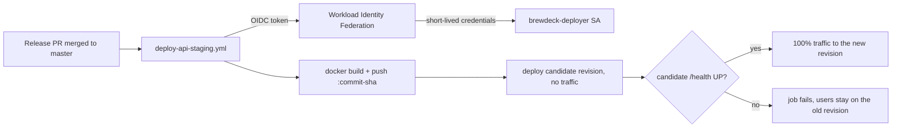

# Staging Deployment (manual runbook)

Step-by-step guide to create BrewDeck's staging environment by hand. The design and its reasons
are in [ADR-017](../decisions/ADR-017-staging-hosting.md) and the
[free hosting spike](../product/spikes/free-hosting-spike.md).

| Part | Service | Free limit (checked 2026-10-15) |
|---|---|---|
| Web (Next.js) | Vercel Hobby | Personal, non-commercial use; stops at its limits instead of billing |
| API (Spring Boot) | Google Cloud Run, `us-central1` | 180,000 vCPU-s, 360,000 GiB-s and 2 M requests per month |
| Database | Neon Free, AWS `us-east-2` | 100 CU-hours per month, 1 GB storage, scales to zero after 5 min |
| Email | Gmail with an app password | About 500 emails per day |
| Images | Artifact Registry | 0.5 GB |
| Secrets | Secret Manager | 6 active secret versions, 10,000 access operations per month |

**Rules for this environment:**

- Staging deploys from **`master`** only, so it changes when a release is merged.
- Registration is **open**.
- The AI assistant stays **off**: the `brew-recipe-ai-assistant` flag is off in `staging` and
  `AI_ENABLED` defaults to `false`.
- Secrets never go in the repository, in this document, or in shell history (the steps below use
  `read -s`).

Do the steps in order. Each step lists what you will need later. Write those values in a private
note (a password manager is best). **Do not commit them.**

## 0. Before you start

You need:

- A Google account for Google Cloud and a card for its billing account.
- A GitHub login for Neon and Vercel.
- A separate Gmail account for sending mail (step 2).
- On your Mac:
  - **Google Cloud CLI:** `brew install --cask google-cloud-sdk`, then `gcloud init`.
  - **Docker Desktop:** running.
  - **`openssl`:** already on macOS.
- A local checkout of `master`:

  ```bash
  git checkout master && git pull
  ```

**Alternative: Google Cloud Shell.** Instead of your Mac, you can run every `gcloud`, `docker` and
`openssl` command in Cloud Shell, the terminal that opens from the `>_` icon in the Cloud Console.

- It already has `gcloud` (logged in), Docker, `git` and `openssl`, so `gcloud auth login` is not
  needed there.
- It runs on **amd64**, like Cloud Run, so the image builds natively. On Apple Silicon the build
  goes through emulation and is slower.
- Its `$HOME` (5 GB) is kept between sessions, but only the files are kept. Exported variables are
  lost, as on any terminal (see below).
- It is a different machine from your Mac. Create `~/brewdeck-staging/env.sh` there too, and clone
  the repository there:

  ```bash
  git clone https://github.com/JuanMelendres/brewdeck.git ~/brewdeck
  cd ~/brewdeck && git checkout master && git pull
  ```

Whichever terminal you use, run the commands **from the repository root**. Steps 4.2 and 9 use
`git rev-parse` for the image tag.

### Shell variables for every terminal

The commands below use `$GCP_PROJECT`, `$REGION` and `$RUNTIME_SA`. An `export` only lasts in the
terminal where you ran it. In a new terminal they are empty, and `gcloud` fails with errors like
`Failed to find attribute [location]`.

So keep them in a file **outside the repository**. These are not secrets.

```bash
mkdir -p ~/brewdeck-staging
echo 'export REGION=us-central1' > ~/brewdeck-staging/env.sh
source ~/brewdeck-staging/env.sh
```

Step 3.2 adds the project id to this file.

> **Every time you open a new terminal for staging, run `source ~/brewdeck-staging/env.sh` first.**
> Check it worked with `echo "$GCP_PROJECT $REGION"`; neither value should be empty.

Keep this private note from now on:

```text
GCP_PROJECT=
REGION=us-central1
NEON_HOST=
NEON_DB=brewdeck
NEON_USER=
MAIL_USER=
API_URL=
WEB_URL=
```

## 1. Neon (PostgreSQL)

1. Go to https://neon.com and **Sign up** with GitHub. Choose the **Free** plan; no card is
   asked for.
2. **Create project:**
   - Project name: `brewdeck-staging`
   - Postgres version: **16** (same as local and CI)
   - Cloud provider and region: **AWS, US East 2 (Ohio)**, the closest Neon region to Cloud Run's
     `us-central1`
   - Database name: `brewdeck`
3. Open **Branches → the default branch (`production`, or `main` in older projects) → Computes → Edit**:
   - Set autoscaling to **0.25 CU min and 0.25 CU max**. This keeps CU-hours low: 100 CU-h is
     about 400 h of awake time.
   - Leave **scale to zero** on (5 minutes).
4. Click **Connect** on the project dashboard:
   - Database: `brewdeck`.
   - Turn **Connection pooling OFF**. The host must **not** contain `-pooler`, because Flyway needs
     a direct connection.
   - Copy the host (`ep-…us-east-2.aws.neon.tech`), the role (user) and the password.
5. Optional: check the connection from your Mac (`brew install libpq` gives you `psql`):

   ```bash
   psql "postgresql://<NEON_USER>@<NEON_HOST>/brewdeck?sslmode=require" -c 'select version();'
   ```

The tables are created later by Flyway when the API starts for the first time. **Do not create
them by hand.**

**Save:** `NEON_HOST`, `NEON_USER`, and the password (only in your password manager).

## 2. Gmail (outgoing mail)

Use a **dedicated** account, for example `brewdeck.staging@gmail.com`, not your personal one. The
app password gives full mail access to that account.

1. Create the Gmail account and sign in.
2. Go to https://myaccount.google.com/security and turn on **2-Step Verification**. App passwords
   need it.
3. Go to https://myaccount.google.com/apppasswords and create an app password named
   `BrewDeck staging`.
4. Google shows a 16-character code. Copy it **without spaces**. It is shown only once.

**Save:** `MAIL_USER` (the Gmail address) and the app password (password manager only).

The SMTP settings used in step 5 are:

- `smtp.gmail.com`, port `587`, STARTTLS.
- The `From` must be this same Gmail address.

Cloud Run only blocks port 25, so 587 works.

## 3. Google Cloud project, billing and guardrails

### 3.1 Billing account

1. Go to https://console.cloud.google.com and accept the terms.
2. Start the free trial ($300 for 90 days) and add your card. During the trial nothing is charged.
3. **Before the trial ends:**
   - Set a calendar reminder for day 80.
   - On that day, open **Billing → Overview** and click **Activate full account**. If you don't,
     the project stops when the trial ends.
   - Cloud Run's monthly free tier keeps applying after activation.

### 3.2 Project

```bash
gcloud auth login
source ~/brewdeck-staging/env.sh
export GCP_PROJECT=brewdeck-staging-$RANDOM    # project IDs are global; keep the one that works
gcloud projects create "$GCP_PROJECT" --name="BrewDeck staging"

# Only after the create succeeded: save the id and the runtime account used in step 5.2.
echo "export GCP_PROJECT=$GCP_PROJECT" >> ~/brewdeck-staging/env.sh
echo 'export RUNTIME_SA="brewdeck-api-runtime@$GCP_PROJECT.iam.gserviceaccount.com"' >> ~/brewdeck-staging/env.sh
source ~/brewdeck-staging/env.sh

gcloud config set project "$GCP_PROJECT"
gcloud config set run/region "$REGION"
gcloud config set artifacts/location "$REGION"

gcloud billing accounts list                   # copy the ACCOUNT_ID
gcloud billing projects link "$GCP_PROJECT" --billing-account=<ACCOUNT_ID>
```

### 3.3 Budget alert

In the console, open **Billing → Budgets & alerts → Create budget**:

- Name: `brewdeck-staging`.
- Scope: project `brewdeck-staging-…`.
- Amount: the smallest amount in your billing currency, for example **USD 1 or MXN 20**.
- Thresholds: 50% and 100% of actual spend, plus 100% of forecasted spend.
- Email alerts to billing admins: on.

> Budget alerts **only notify**; they do not stop spending. The real caps are `--max-instances=1`
> (step 5) and the small image registry.

### 3.4 APIs

```bash
gcloud services enable run.googleapis.com artifactregistry.googleapis.com secretmanager.googleapis.com
```

## 4. Image registry and the first image

### 4.1 Artifact Registry with a cleanup policy

```bash
gcloud artifacts repositories create brewdeck \
  --repository-format=docker --location="$REGION" --description="BrewDeck images"

cat > /tmp/brewdeck-cleanup.json <<'EOF'
[
  {"name": "keep-latest-2", "action": {"type": "Keep"}, "mostRecentVersions": {"keepCount": 2}},
  {"name": "delete-older", "action": {"type": "Delete"}, "condition": {"olderThan": "1d"}}
]
EOF
gcloud artifacts repositories set-cleanup-policies brewdeck \
  --location="$REGION" --policy=/tmp/brewdeck-cleanup.json --no-dry-run
```

Each image is about 206 MB compressed. Keeping 2 stays under the 0.5 GB free storage.

### 4.2 Build and push

Cloud Run runs **amd64**. Run this from the repository root, on `master`:

```bash
source ~/brewdeck-staging/env.sh
cd ~/brewdeck            # or wherever your checkout is
git checkout master && git pull
gcloud auth configure-docker "$REGION-docker.pkg.dev"

export IMAGE="$REGION-docker.pkg.dev/$GCP_PROJECT/brewdeck/brewdeck-api:$(git rev-parse --short HEAD)"
echo "$IMAGE"            # must end in :<commit>, not in a bare ':'
```

Then build and push, depending on where you are:

- **Mac (Apple Silicon):** build for amd64 explicitly. Maven runs under emulation, so the first
  build takes several minutes. A plain `docker build` on the Mac makes an **arm64** image, which
  Cloud Run rejects. `--provenance=false` skips the attestation, so the registry gets a single amd64
  manifest instead of an index.

  ```bash
  docker buildx build --platform linux/amd64 --provenance=false -t "$IMAGE" --push brewdeck-api
  ```

- **Cloud Shell:** it is already amd64.

  ```bash
  docker build -t "$IMAGE" brewdeck-api && docker push "$IMAGE"
  ```

Check the platform before deploying:

```bash
docker buildx imagetools inspect "$IMAGE"    # must show Platform: linux/amd64
```

If it shows `linux/arm64`, rebuild with the Mac command above, using the same tag. Otherwise
step 5.4 fails with `Container manifest type 'application/vnd.oci.image.index.v1+json' must
support amd64/linux`.

Notes:

- `gcloud auth configure-docker` may print a long `WARNING` listing `credHelpers`. That is
  informational; the line that matters is `gcloud credential helpers already registered correctly`.
- If the tag ends in a bare `:` and the build fails with `invalid reference format`, you are not
  inside the repository. `git rev-parse` failed with `fatal: not a git repository`.
- `brewdeck-api/Dockerfile` must exist on `master`, so the release with #241 must be merged first.

## 5. API on Cloud Run

### 5.1 Secrets

`read -s` keeps the values out of your terminal and shell history.

```bash
openssl rand -base64 48 | tr -d '\n' | gcloud secrets create brewdeck-jwt-secret --data-file=-

read -rs DB_PASS && printf '%s' "$DB_PASS" | gcloud secrets create brewdeck-db-password --data-file=- && unset DB_PASS
read -rs MAIL_PASS && printf '%s' "$MAIL_PASS" | gcloud secrets create brewdeck-mail-password --data-file=- && unset MAIL_PASS
```

The first `read` waits for the Neon password; the second waits for the Gmail app password.

### 5.2 Runtime service account (least privilege)

The default Compute service account has the broad Editor role, so the API gets its own account.
It can only read these three secrets.

```bash
gcloud iam service-accounts create brewdeck-api-runtime --display-name="BrewDeck API runtime"
echo "$RUNTIME_SA"    # set by env.sh in step 3.2; must not be empty

for s in brewdeck-jwt-secret brewdeck-db-password brewdeck-mail-password; do
  gcloud secrets add-iam-policy-binding "$s" \
    --member="serviceAccount:$RUNTIME_SA" --role=roles/secretmanager.secretAccessor
done
```

### 5.3 Environment file

`DB_URL` contains `?`, which is awkward on the command line, so use a YAML file **outside the
repository**:

```bash
cat > ~/brewdeck-staging/api.env.yaml <<'EOF'
SPRING_PROFILES_ACTIVE: "staging"
DB_URL: "jdbc:postgresql://<NEON_HOST>/brewdeck?sslmode=require"
DB_USER: "<NEON_USER>"
# Replaced with the real Vercel URL in step 6.4.
CORS_ALLOWED_ORIGINS: "https://brewdeck-staging.vercel.app"
BREWDECK_MAIL_FRONTEND_BASE_URL: "https://brewdeck-staging.vercel.app"
BREWDECK_MAIL_ENABLED: "true"
# Keep the angle brackets: the value is "Name <address>". Without them every email fails.
BREWDECK_MAIL_FROM: "BrewDeck <you.staging@gmail.com>"
SPRING_MAIL_HOST: "smtp.gmail.com"
SPRING_MAIL_PORT: "587"
SPRING_MAIL_USERNAME: "you.staging@gmail.com"
SPRING_MAIL_SMTP_AUTH: "true"
SPRING_MAIL_SMTP_STARTTLS: "true"
EOF
```

Replace `<NEON_HOST>`, `<NEON_USER>` (brackets included) and `you.staging@gmail.com` with your
values. In `BREWDECK_MAIL_FROM` the `< >` are part of the address syntax and must stay. Since
#248 the API refuses to start with an invalid sender, instead of failing every email on a
background thread. Leave these out on purpose:

- `AI_ENABLED`: defaults to `false`.
- `FORWARD_HEADERS_STRATEGY`: defaults to `none`, so a client cannot spoof its IP.
- `API_DOCS_ENABLED`: defaults to `false`.

### 5.4 Deploy

```bash
gcloud run deploy brewdeck-api-staging \
  --image="$IMAGE" \
  --region="$REGION" \
  --service-account="$RUNTIME_SA" \
  --cpu=1 --memory=1Gi --cpu-boost \
  --min-instances=0 --max-instances=1 \
  --allow-unauthenticated \
  --env-vars-file="$HOME/brewdeck-staging/api.env.yaml" \
  --set-secrets=DB_PASSWORD=brewdeck-db-password:latest,BREWDECK_JWT_SECRET=brewdeck-jwt-secret:latest,SPRING_MAIL_PASSWORD=brewdeck-mail-password:latest
```

What the settings mean:

- `--allow-unauthenticated` is needed because Vercel calls the API like any browser would. The app
  still requires a JWT for every `/api/**` route except the public ones.
- `--min-instances=0` with the default request-based billing means idle time costs nothing.
- `--max-instances=1` is the cost cap. It also keeps the in-memory rate limits and caches on a
  single instance.
- `--memory=1Gi` (raised from 512 MiB on 2026-10-20). With 512 MiB, Cloud Run killed the container
  on cold start plus the first requests (`Memory limit of 512 MiB exceeded`, on 2026-10-15, 10-16
  and 10-20). The JVM takes 75% of the limit as heap (`MaxRAMPercentage=75` in the `Dockerfile`),
  which left about 128 MiB for metaspace, threads and the code cache. Argon2id's 19 MiB per hash
  (ADR-018) pushed it over. The free tier still binds on CPU (about 50 active hours a month), not
  memory (about 100 hours at 1 GiB).
- The deploy pipeline does not pass `--memory`, so new revisions keep the service's setting.
- Cloud Run sets `PORT=8080`, and the `staging` profile reads it.

### 5.5 Check

```bash
export API_URL=$(gcloud run services describe brewdeck-api-staging --format='value(status.url)')
curl -s "$API_URL/health"                  # {"status":"UP"}
curl -s -o /dev/null -w '%{http_code}\n' "$API_URL/api/coffees"   # 401 (needs login)

gcloud logging read \
  'resource.type="cloud_run_revision" AND resource.labels.service_name="brewdeck-api-staging"' \
  --limit=200 --format='value(textPayload)' | grep -E 'Successfully applied|Started Brewdeck|ERROR'
```

Right after a deploy, or after the service has been idle, the health check may answer
`{"status":"OUT_OF_SERVICE"}` for a few seconds. That is Spring's readiness state while the instance
is still starting: Tomcat already listens, but Flyway and the context are not done yet. Repeat the
`curl` after 10–20 s. Only a `DOWN`, or an `OUT_OF_SERVICE` that does not go away, needs the logs.

The first start against Neon should log `Successfully applied 28 migrations` (or the current
count) and `Started BrewdeckApiApplication`.

If it fails:

| Error in the logs | Cause and fix |
|---|---|
| `Could not resolve placeholder` | An env var or secret is missing. |
| `BREWDECK_MAIL_FROM` is not a valid sender address | Use `"BrewDeck <address@gmail.com>"`, keeping the angle brackets. |
| `password authentication failed` | Check `DB_USER` and the secret value. |
| `SSL` errors | Check `sslmode=require`. |
| Flyway errors with `-pooler` in the host | Use the direct endpoint (step 1.4). |

**Save:** `API_URL` (`https://brewdeck-api-staging-….run.app`).

## 6. Web on Vercel

### 6.1 Import the project

1. Go to https://vercel.com, **Sign up** with GitHub, and choose **Hobby**.
2. Click **Add New → Project**.
3. Install the Vercel GitHub app for **only** the `JuanMelendres/brewdeck` repository, then
   **Import** it.
4. Configure:
   - **Project name:** `brewdeck-staging`. This gives `https://brewdeck-staging.vercel.app` if the
     name is free; otherwise note the URL Vercel assigns.
   - **Framework preset:** Next.js.
   - **Root directory:** `brewdeck-web`.
   - **Build and Output Settings:** turn **Override** on for both commands:

     | Field | Value |
     |---|---|
     | Install Command | `npx pnpm@11.27.1 install --frozen-lockfile` |
     | Build Command | `npx pnpm@11.27.1 run build` |

     Vercel's own pnpm is too old for our lockfile. It warns `Ignoring not compatible lockfile`,
     then fails with `ERR_INVALID_THIS`. Corepack (`ENABLE_EXPERIMENTAL_COREPACK=1`) does not help
     either: Vercel looks for `packageManager` in the **repository root** `package.json`, which this
     monorepo does not have (`Could not enable corepack because package.json is missing
     "packageManager"`). Keep the version in sync with `brewdeck-web/package.json`.
   - **Environment variables** (Production):

     | Name | Value | Notes |
     |---|---|---|
     | `API_PROXY_TARGET` | your `API_URL`, no trailing slash | Read at **build** time by `next.config.ts` |

     **Do not** set `NEXT_PUBLIC_API_BASE_URL`. The browser must only talk to the Vercel origin,
     otherwise the refresh cookie breaks ([ADR-013](../decisions/ADR-013-refresh-token-cookie.md)).
5. Click **Deploy**. This first build uses the repository's default branch (`develop`); step 6.2
   switches it to `master`.

### 6.2 Deploy from `master` only

In **Project → Settings**:

1. **Git → Production Branch:** `master`.
2. **Build and Deployment → Ignored Build Step:** choose **Only build production**, so pushes to
   other branches don't create preview builds.
3. **Build & Deployment → Node.js Version:** **22.x** (`package.json` asks for Node ≥ 22).

Then rebuild from `master`: **Deployments → Create Deployment**, branch `master` (or merge
anything into `master`). Check that the production deployment shows branch `master`.

### 6.3 Check the build log

- The install step must **not** show `Ignoring not compatible lockfile` or `ERR_INVALID_THIS`.
  If it does, the overrides from step 6.1 are missing.
- The `Ignored Build Step` line (`if [ "$VERCEL_ENV" == "production" ]; then exit 1; ...`) exiting
  with 1 is correct. It means "build this one", because production builds.
- After changing settings or env vars, use **Deployments → … → Redeploy** with **Use existing
  Build Cache** unchecked. Settings only apply to new builds.

**Save:** `WEB_URL` (the production domain, for example `https://brewdeck-staging.vercel.app`).

### 6.4 Point the API at the real web URL

If `WEB_URL` differs from the placeholder in step 5.3, update both URLs. Also edit them in
`~/brewdeck-staging/api.env.yaml`, so the file stays the record of what runs:

```bash
gcloud run services update brewdeck-api-staging \
  --update-env-vars=CORS_ALLOWED_ORIGINS=<WEB_URL>,BREWDECK_MAIL_FRONTEND_BASE_URL=<WEB_URL>
```

`--update-env-vars` changes only the listed variables; the others and the secrets stay. The update
creates a new revision.

## 7. Smoke test (desktop and phone)

1. **Register:** open `WEB_URL` and register a new account. Registration is open.
2. **Refresh cookie:** log in, then reload the page. You should stay logged in.
3. **Data:**
   - Create a coffee, a recipe and a brew session.
   - Check the dashboard.
   - Switch to Spanish and change the theme.
4. **Password reset:**
   - Log out, then click **Forgot password**.
   - The email should arrive at the address you registered with (check spam).
   - Follow the link: it must open `WEB_URL`. Reset the password and log in with the new one.
5. **AI:** the AI buttons should not show (flag off).
6. **Cold start:** wait **20+ minutes** and load the app again.
   - The first request takes a few extra seconds while Cloud Run and Neon wake up.
   - It should not fail.
7. **Phone:** repeat steps 2–4 on your phone, and try **Add to Home screen**.

## 8. Optional: admin account

1. Register the account you want as admin and open the verification link from its email.
   Unverified accounts are not promoted; the log shows a warning instead.
2. Set it, and add the same line to `~/brewdeck-staging/api.env.yaml`:

   ```bash
   gcloud run services update brewdeck-api-staging --update-env-vars=BREWDECK_ADMIN_EMAIL=<that email>
   ```

3. The update creates a new revision. The new revision
   promotes the account at startup ([ADR-009](../decisions/ADR-009-role-based-authorization.md)).

## 9. Updating staging by hand

Once step 12 is set up, releases deploy by themselves; use this section as the fallback.

Staging follows `master`.

1. Merge the release PR `develop → master`.
2. **Web:** Vercel deploys `master` by itself, so nothing to do.
3. **API:** build and deploy the new commit.

   ```bash
   source ~/brewdeck-staging/env.sh
   cd ~/brewdeck && git checkout master && git pull    # your checkout, on the Mac or in Cloud Shell
   export IMAGE="$REGION-docker.pkg.dev/$GCP_PROJECT/brewdeck/brewdeck-api:$(git rev-parse --short HEAD)"
   docker buildx build --platform linux/amd64 -t "$IMAGE" --push brewdeck-api
   gcloud run deploy brewdeck-api-staging --image="$IMAGE" --region="$REGION"
   ```

   A redeploy with only `--image` keeps the env vars, secrets and limits.

**Order when a release has new migrations:**

- Deploy the **API first**. Flyway runs on startup, and the web keeps working because API changes
  are additive.
- If a release removes something the old web uses (like #237's `ui-config`), deploy both close
  together.

**Rollback:**

- **API:** list the revisions, then send all traffic to an earlier one.

  ```bash
  gcloud run revisions list --service=brewdeck-api-staging
  gcloud run services update-traffic brewdeck-api-staging --to-revisions=<REVISION>=100
  ```

  The next `gcloud run deploy` sends traffic to the newest revision again.
- **Web:** Vercel **Deployments → … → Instant Rollback** on an earlier production deployment.
- **Database:** Flyway only moves forward. If a release needs the old schema back, use Neon
  **Restore** (6-hour window on Free) to a point before the deploy, then roll back the API.
- **Not backward compatible: V31** (temperatures `INTEGER` → `NUMERIC(4,1)`, DATA-01). API
  revisions built before V31 fail Hibernate's schema validation against the migrated database, so
  sending traffic back to one of them does not work. Fix forward. Going back means Neon
  **Restore** to before the deploy **and** an older revision, which also loses any decimal
  temperatures saved since. Deploy the API and the web together for this release.

## 10. Watching cost and usage

Check monthly, or when a budget email arrives:

- **Google Cloud:**
  - **Billing → Reports**, filtered to the project. It should show $0 after credits and the free
    tier.
  - **Artifact Registry:** at most 2 images.
  - **Cloud Run → Jobs → brewdeck-retention-staging:** one execution a day, all succeeded (step 13).
- **Neon:** **Billing / Usage**. Watch CU-hours (limit 100), storage and egress.
- **Vercel:** **Usage**. Watch Active CPU (4 h), requests and data transfer.

## 11. Tear down

When staging is no longer needed:

1. Google Cloud:

   ```bash
   gcloud scheduler jobs delete brewdeck-retention-daily --location="$REGION"
   gcloud run jobs delete brewdeck-retention-staging --region="$REGION"
   gcloud run services delete brewdeck-api-staging
   gcloud artifacts repositories delete brewdeck --location="$REGION"
   gcloud secrets delete brewdeck-jwt-secret
   gcloud secrets delete brewdeck-db-password
   gcloud secrets delete brewdeck-mail-password
   gcloud projects delete "$GCP_PROJECT"
   ```

2. Neon: **Project settings → Delete project**.
3. Vercel: **Settings → Advanced → Delete Project**. Then remove the Vercel GitHub app
   (GitHub → Settings → Applications).
4. Gmail: revoke the app password at https://myaccount.google.com/apppasswords.

## Security notes

- **Open registration on a public URL:**
  - Anyone can create an account. Data stays per-user (ownership checks on every read and write).
  - Auth rate limits apply, but the per-IP limits act as one shared bucket behind the proxy
    ([ADR-011](../decisions/ADR-011-in-memory-auth-rate-limiting.md)). Per-account limits still work.
- **Direct API URL:** the `run.app` URL is public. It answers the same API with the same auth; the
  browser never needs it.
- **Rotating a secret:**

  ```bash
  printf '%s' "<new value>" | gcloud secrets versions add <secret> --data-file=-
  ```

  Then redeploy. Rotating `brewdeck-jwt-secret` logs everyone out.
- **Sensitive data:** do not put real personal data in staging.
- **Crawlers and bots:**
  - Staging is `noindex`: `robots.txt` disallows everything, pages carry the meta tag and every
    response carries an `X-Robots-Tag` header, unless `ALLOW_INDEXING=true`. Polite crawlers
    (Google, Bing) obey this.
  - For the rest, use Vercel's free firewall (**Project → Firewall**). Set **AI Bots** to *Deny*.
    Set **Bot Protection** to *Log* first, check that it does not flag the app's own `/api/*`
    calls, then switch it to *Challenge*. **Attack Challenge Mode** is the panic button.
  - The `run.app` URL bypasses Vercel's firewall. Restricting it to the Next proxy (a shared-secret
    header) is planned for production.

## 12. Automated API deploys (GitHub Actions)

`.github/workflows/deploy-api-staging.yml` deploys the API every time `master` changes under
`brewdeck-api/`, which means every release that touches the API. The web needs nothing new: Vercel
already deploys `master` (step 6.2).

### 12.1 How it works



- **No keys anywhere:**
  - GitHub gives the job a signed OIDC token. Google accepts it only from this repository
    (`repository_id` 1226185460) and only on `refs/heads/master`.
  - Google then hands out credentials that expire within the hour.
  - There is no JSON key to leak or rotate.
- **No downtime and an automatic safety net:**
  - The new revision starts with no traffic, under the tag `candidate`.
  - Only when its health check reports `UP` does traffic move to it.
  - If it never becomes healthy, the job fails and users keep the previous revision.
- **Tests are not repeated:** the release PR into `master` already ran `api-ci` (tests, Spotless,
  PMD, JaCoCo). Merge only when those checks are green.
- **Migrations:** Flyway runs when the candidate starts, while the old revision is still serving.
  Keep migrations additive, so both revisions work on the new schema. V31 is the one exception
  (see **Rollback** in step 9). Any future type change in production needs expand/contract: add the
  new column, write both, backfill, switch reads, then drop the old one.
- **Retention job:** after traffic moves, the workflow points the `brewdeck-retention-staging`
  Cloud Run Job at the same image (step 13). It skips this when the job does not exist.
- **Manual run:** **Actions → Deploy API to staging → Run workflow** on `master`. Useful after
  changing env vars or secrets, or to redeploy the same commit. The job refuses other branches.

### 12.2 One-time Google Cloud setup

Run these in Cloud Shell or on the Mac, after `source ~/brewdeck-staging/env.sh`.

```bash
source ~/brewdeck-staging/env.sh
export PROJECT_NUMBER=$(gcloud projects describe "$GCP_PROJECT" --format='value(projectNumber)')
export REPO_ID=1226185460      # gh api repos/JuanMelendres/brewdeck -q .id
echo "$GCP_PROJECT $PROJECT_NUMBER $REGION $REPO_ID"

gcloud services enable iamcredentials.googleapis.com sts.googleapis.com
```

**Identity pool and GitHub provider.** The condition is the security boundary: only this
repository, only `master`.

```bash
gcloud iam workload-identity-pools create github   --location=global --display-name="GitHub Actions"

gcloud iam workload-identity-pools providers create-oidc brewdeck   --location=global --workload-identity-pool=github   --display-name="BrewDeck repository"   --issuer-uri="https://token.actions.githubusercontent.com"   --attribute-mapping="google.subject=assertion.sub,attribute.repository_id=assertion.repository_id,attribute.ref=assertion.ref"   --attribute-condition="assertion.repository_id=='$REPO_ID' && assertion.ref=='refs/heads/master'"
```

The condition matches on the numeric repository id, not the name. If the repository is ever
renamed or deleted, somebody else reusing the name still cannot deploy.

**Deployer service account.** It can push images and deploy this project's Cloud Run services,
and nothing else. It is a separate account from the runtime one, which only reads secrets.

```bash
gcloud iam service-accounts create brewdeck-deployer   --display-name="BrewDeck staging deployer (GitHub Actions)"
export DEPLOY_SA="brewdeck-deployer@$GCP_PROJECT.iam.gserviceaccount.com"
echo "export DEPLOY_SA=$DEPLOY_SA" >> ~/brewdeck-staging/env.sh

# Who may act as the deployer: workflows from this repository (the provider adds "master only").
gcloud iam service-accounts add-iam-policy-binding "$DEPLOY_SA"   --role=roles/iam.workloadIdentityUser   --member="principalSet://iam.googleapis.com/projects/$PROJECT_NUMBER/locations/global/workloadIdentityPools/github/attribute.repository_id/$REPO_ID"

# What the deployer may do.
gcloud artifacts repositories add-iam-policy-binding brewdeck --location="$REGION"   --member="serviceAccount:$DEPLOY_SA" --role=roles/artifactregistry.writer
gcloud projects add-iam-policy-binding "$GCP_PROJECT"   --member="serviceAccount:$DEPLOY_SA" --role=roles/run.developer --condition=None
# Deploying a revision that runs as brewdeck-api-runtime requires "act as" on that account.
gcloud iam service-accounts add-iam-policy-binding "$RUNTIME_SA"   --member="serviceAccount:$DEPLOY_SA" --role=roles/iam.serviceAccountUser
```

**Values for GitHub:**

```bash
echo "GCP_PROJECT_ID=$GCP_PROJECT"
echo "GCP_REGION=$REGION"
echo "GCP_WORKLOAD_IDENTITY_PROVIDER=projects/$PROJECT_NUMBER/locations/global/workloadIdentityPools/github/providers/brewdeck"
echo "GCP_DEPLOY_SERVICE_ACCOUNT=$DEPLOY_SA"
```

### 12.3 One-time GitHub setup

1. In the repository, open **Settings → Environments → New environment** and name it `staging`.
2. **Deployment branches and tags:** choose **Selected branches and tags** and add `master`.
3. Optional: under **Required reviewers**, add yourself. Each deploy then waits for your approval
   in the Actions run.
4. **Environment variables** (these are not secrets; WIF has none). Add the four values from 12.2:
   `GCP_PROJECT_ID`, `GCP_REGION`, `GCP_WORKLOAD_IDENTITY_PROVIDER`, `GCP_DEPLOY_SERVICE_ACCOUNT`.

### 12.4 First run and checks

1. The workflow file reaches `master` with the next release, and that push runs it by itself,
   because the file is one of its paths. Or run it by hand (12.1).
2. Watch **Actions → Deploy API to staging**:
   - the candidate health attempts should end in `"status":"UP"`;
   - the summary shows the commit, revision and image.
3. Check that traffic moved:

   ```bash
   gcloud run services describe brewdeck-api-staging --region="$REGION" \
     --format='table(status.traffic[].revisionName, status.traffic[].percent, status.traffic[].tag)'
   ```

   The newest revision gets 100%. The tag `candidate` stays on it, which is harmless; the next
   deploy moves it.

| Error in the job | Cause and fix |
|---|---|
| `Permission 'iam.serviceAccounts.getAccessToken' denied` | The `workloadIdentityUser` binding or the provider condition does not match. Check `REPO_ID`, and that the run is on `master`. |
| `The given credential is rejected by the attribute condition` | The run was not on `refs/heads/master`. |
| `artifactregistry.repositories.uploadArtifacts` denied | The `artifactregistry.writer` binding on the `brewdeck` repository is missing. |
| `iam.serviceaccounts.actAs` denied | The `serviceAccountUser` binding on `brewdeck-api-runtime` is missing. |
| Candidate never `UP` | Read the candidate revision's logs (step 5.5). Users were not affected. |

**Rollback** stays as in step 9: send traffic back to an earlier revision with
`update-traffic --to-revisions`. The next successful deploy moves traffic forward again.

### 12.5 Turning it off

Disable the workflow under **Actions → Deploy API to staging → … → Disable workflow**.

To remove access completely:

```bash
gcloud iam workload-identity-pools delete github --location=global
gcloud iam service-accounts delete "$DEPLOY_SA"
```

## 13. Retention purge job (AUTH-06)

**Status:** set up on 2026-10-21. The first manual execution reminded 4 unverified accounts and sent
4 emails before exiting. A run started by the scheduler then finished with nothing new to do
(`reminded=0`).

A Cloud Run Job runs the API image once a day in a one-shot mode
(`BREWDECK_RETENTION_RUN_ONCE=true`). It does the following, then exits:
- reminds and deletes unverified accounts, because `auth-require-email-verification` is on in
  staging;
- deletes token rows 30 days after they expire.

Design: [ADR-021](../decisions/ADR-021-retention-purge.md). The job has no ingress. Cloud Scheduler
starts it through the Cloud Run Admin API, so no endpoint is exposed.

> **First run on staging:** every unverified account older than 5 days gets a reminder email at
> once. Two days later, any of those accounts that is still unverified is **deleted with its data**.

### 13.1 Create the job

**Only after the service runs a release with the one-shot mode** (#307). An older image ignores
`BREWDECK_RETENTION_RUN_ONCE`, starts a normal server and never exits; the 10-minute timeout would
then kill every execution.

Run these after `source ~/brewdeck-staging/env.sh`. The job uses the same runtime account,
secrets and env values as the service, plus the one-shot switch.

The env file is copied from the **live service**, not from `api.env.yaml`, which can be out of
date. On 2026-10-21 its `BREWDECK_MAIL_FROM` no longer matched the service. Secrets are not in it;
they come from Secret Manager below.

```bash
source ~/brewdeck-staging/env.sh
gcloud run services describe brewdeck-api-staging --region="$REGION" --format=json | python3 -c '
import json, sys
env = json.load(sys.stdin)["spec"]["template"]["spec"]["containers"][0].get("env", [])
for e in env:
    if "value" in e:
        print("%s: %s" % (e["name"], json.dumps(e["value"])))
print("BREWDECK_RETENTION_RUN_ONCE: \"true\"")
' > ~/brewdeck-staging/retention.env.yaml
chmod 600 ~/brewdeck-staging/retention.env.yaml

# Start from the image the service runs now; each deploy updates it afterwards (12.1).
IMAGE=$(gcloud run services describe brewdeck-api-staging --region="$REGION" \
  --format='value(spec.template.spec.containers[0].image)')

gcloud run jobs deploy brewdeck-retention-staging \
  --image="$IMAGE" \
  --region="$REGION" \
  --service-account="$RUNTIME_SA" \
  --cpu=1 --memory=1Gi \
  --tasks=1 --max-retries=1 --task-timeout=10m \
  --env-vars-file="$HOME/brewdeck-staging/retention.env.yaml" \
  --set-secrets=DB_PASSWORD=brewdeck-db-password:latest,BREWDECK_JWT_SECRET=brewdeck-jwt-secret:latest,SPRING_MAIL_PASSWORD=brewdeck-mail-password:latest
```

- `--max-retries=1`: a failed run (exit code 1) is retried once. Every step is idempotent, so a
  retry only finishes what is left.
- `--task-timeout=10m` stops a hung run. A normal run takes under a minute: about 20 s to start,
  then the purge.
- When you change the service's env values, regenerate the file as above, then run
  `gcloud run jobs update brewdeck-retention-staging --region="$REGION" --env-vars-file="$HOME/brewdeck-staging/retention.env.yaml"`.

### 13.2 Run it once by hand

```bash
gcloud run jobs execute brewdeck-retention-staging --region="$REGION" --wait
gcloud logging read 'resource.type="cloud_run_job" AND resource.labels.job_name="brewdeck-retention-staging" AND textPayload:"Retention purge"' \
  --freshness=1h --limit=5 --format='value(timestamp,textPayload)'
```

Expected: `Retention purge done: reminded=N, deleted=0, failures=0, tokensDeleted=M`. Deletions
start no earlier than 2 days after the first reminders.

### 13.3 Daily trigger (Cloud Scheduler)

The scheduler gets its own service account. That account may only start this job.

```bash
gcloud services enable cloudscheduler.googleapis.com

gcloud iam service-accounts create brewdeck-scheduler --display-name="BrewDeck retention scheduler"
export SCHEDULER_SA="brewdeck-scheduler@$GCP_PROJECT.iam.gserviceaccount.com"
echo "export SCHEDULER_SA=$SCHEDULER_SA" >> ~/brewdeck-staging/env.sh

gcloud run jobs add-iam-policy-binding brewdeck-retention-staging --region="$REGION" \
  --member="serviceAccount:$SCHEDULER_SA" --role=roles/run.invoker

gcloud scheduler jobs create http brewdeck-retention-daily \
  --location="$REGION" \
  --schedule="0 4 * * *" --time-zone="America/Mexico_City" \
  --uri="https://run.googleapis.com/v2/projects/$GCP_PROJECT/locations/$REGION/jobs/brewdeck-retention-staging:run" \
  --http-method=POST \
  --oauth-service-account-email="$SCHEDULER_SA"
```

- It runs every day at 04:00, Mexico City time.
- To test the trigger, run `gcloud scheduler jobs run brewdeck-retention-daily --location="$REGION"`,
  then read the logs as in 13.2.
- **Cost:** about 1 vCPU-minute a day, inside the Cloud Run free tier. Cloud Scheduler gives 3
  jobs free per billing account. Neon wakes for a few minutes a day.

### 13.4 Pause or remove

```bash
gcloud scheduler jobs pause brewdeck-retention-daily --location="$REGION"    # resume: ... resume
gcloud scheduler jobs delete brewdeck-retention-daily --location="$REGION"
gcloud run jobs delete brewdeck-retention-staging --region="$REGION"
```

The deploy pipeline skips the job update when the job does not exist.

| Problem | Cause and fix |
|---|---|
| Execution failed, log shows `Retention purge failed for user id=N` | One account failed; the others went through. Read the stack trace under that line. |
| Execution failed before `Started BrewdeckApiApplication` | Same causes as a service cold start: a secret, `DB_URL` or the mail sender. Compare `retention.env.yaml` with `api.env.yaml`. |
| `add-iam-policy-binding`: `Service account ... does not exist` right after creating it | IAM takes a minute to see a new account. Wait and run the binding again. |
| `gcloud scheduler jobs create`: `NOT_FOUND` right after enabling the API | Same propagation delay. Wait a minute and retry. |
| Scheduler shows `PERMISSION_DENIED` | The `run.invoker` binding on the job is missing, or the scheduler uses a different service account. |
| Pipeline step `Update retention job image` denied | The deployer needs `roles/run.developer`, which it already has from 12.2, and `serviceAccountUser` on the runtime account. |

## Next

Optional follow-ups:

- A branch protection rule on `master` that requires `api-ci` and `web-ci` checks.
- Post-deploy smoke tests with Playwright.
